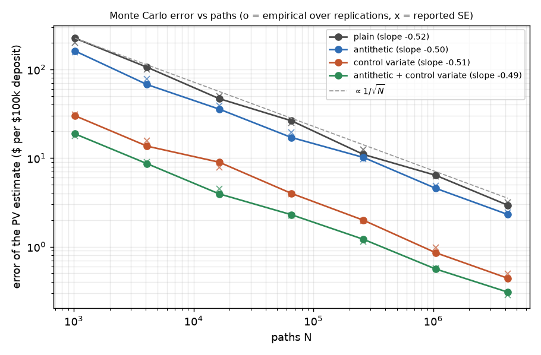
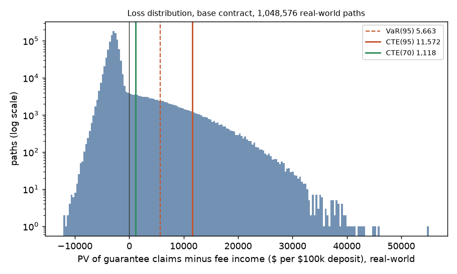
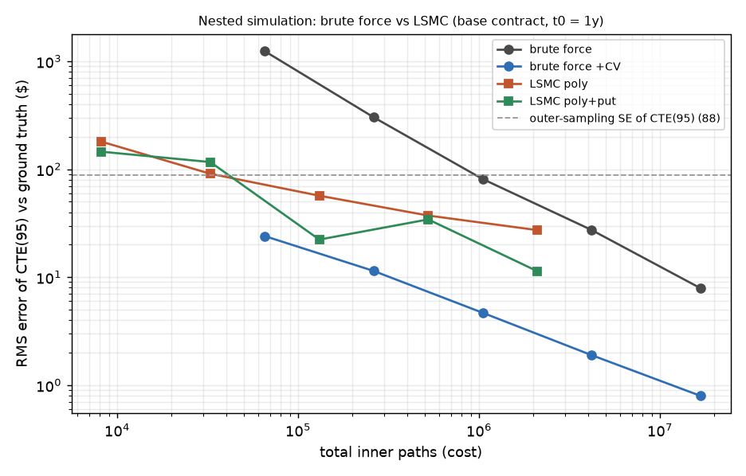

# LEARNING.md

Notes written to teach the ideas behind segfund-mc, one section per phase.
This is an educational model. Nothing here is actuarially approved or regulatory-grade.

---

## Phase 1: the CPU fp64 reference model and closed-form validation

### 1.1 The finance: what is being valued

**A segregated fund contract** is a Canadian insurance product. The client's money
goes into an investment fund (held "segregated" from the insurer's general assets),
but the insurer adds guarantees:

- **GMMB (guaranteed minimum maturity benefit):** at maturity (often 10 years) the
  client gets at least, say, 75% or 100% of what they deposited.
- **GMDB (guaranteed minimum death benefit):** if the client dies first, their
  beneficiary gets at least, say, 100% of deposits.

Fund value F, guarantee G. At maturity the client gets max(F, G) = F + max(G − F, 0).
The fund pays the F part. The insurer pays **max(G − F, 0)**, which is exactly the
payoff of a **put option** on the fund with strike G. So the insurer is *short a put*.
It gets paid for that put through a fee, part of the fund's MER (management
expense ratio). In our base contract the MER is 2.25% a year, of which 0.40% is the
guarantee fee kept by the insurer.

It is not a plain exchange-traded put because:
- the maturity is long (10 to 30 years), so interest rates matter a lot;
- the payoff only happens if the client is still there, so it depends on
  **mortality** (death triggers the GMDB instead) and **lapses** (clients who
  surrender walk away from the guarantee, and the insurer loses their future fees);
- lapses depend on the market: when the guarantee is valuable (F well below G),
  rational clients keep it, so lapse rates fall exactly when the insurer is losing.
  That's *dynamic lapse*.
- the fee is paid as a percentage of F, so fee income drops just as claims rise.

**Liability per policy** = PV(claims) − PV(fee income). Positive means the
guarantee costs more than the fees bring in.

**Risk-neutral vs real-world measures (preview, used fully in phases 4 and 5).**
- *Risk-neutral (Q):* the measure used for **pricing**. Every asset grows at the
  risk-free rate on average, so discounted asset prices are martingales. The value
  is "what it would cost to hedge", not a forecast.
- *Real-world (P):* the measure used for **risk measurement**. Equities earn a
  risk premium, and the scenarios are meant to look like plausible futures. Capital
  is set from tail outcomes under P.

The config switches between them with `economy.measure`. Under P we add an
equity risk premium and a market price of interest-rate risk.

**CTE (preview, phase 4).** CTE(α) is the average loss in the worst (100 − α)% of
scenarios. CTE(95) is the mean of the worst 5% of outcomes. Canadian seg fund
capital (OSFI's LICAT framework) uses CTE-type tail measures. Unlike a single
percentile (VaR), CTE looks at how bad the tail is, not just where it starts.

### 1.2 The math

**Hull-White one-factor model**

    dr = (θ(t) − a r) dt + σ dW

The short rate r reverts towards a moving target at speed a, with normal shocks
of size σ. θ(t) is chosen so the model reproduces today's yield curve exactly.

We use the equivalent form r(t) = x(t) + φ(t), where x is a zero-mean
Ornstein-Uhlenbeck process (dx = −a x dt + σ dW) and φ(t) is deterministic. This
makes simulation exact. Over one step of length h, both x and its integral
Y = ∫x dt are Gaussian, with closed-form mean and variance:

    x_t = x_s e^(−ah) + ε1,        Var ε1 = σ²(1 − e^(−2ah)) / (2a)
    Y   = x_s B(h)    + ε2,        B(h) = (1 − e^(−ah)) / a

The discount factor is exp(−∫r), and ∫r = Y + ∫φ. We never discretise the
stochastic differential equation, so the bond-price test has no time-step bias.

Bond price formula: P(t,T) = [P(0,T)/P(0,t)] · exp(½[V(t,T) − V(0,T) + V(0,t)] − B(T−t) x(t)).
Higher x(t) means a lower bond price, as expected.

*Why Hull-White?* It's the simplest model that (1) fits today's curve exactly,
(2) has closed-form bond prices, and (3) allows exact simulation. Its downside is
that rates are Gaussian and can go negative. Alternatives: CIR (no negative
rates, but no exact fit to the curve without a shift), two-factor G2++ (better
curve dynamics), LIBOR/SOFR market models (heavier). Insurers' economic scenario
generators often use multi-factor models. One factor is a deliberate
simplification here.

**Equity fund under stochastic rates**

    dF/F = (r − MER) dt + σ_S dW_S,    corr(dW_S, dW) = ρ

Under Q the fund earns the short rate minus fees. The MER acts like a dividend
yield, money leaking out of the fund.

**Cholesky.** Each step needs three *correlated* normals (ε1, ε2, and the equity
shock). We work out their 3×3 covariance matrix C in closed form (formulas in
`models/equity.py`) and factor C = L Lᵀ, with L lower-triangular. If z is three
independent standard normals, then L z has covariance exactly C. That's all
Cholesky does here: it turns independent noise into noise with the right
correlations. The test `test_step_covariance_against_quadrature` checks every
entry of C against numerical integration.

**Mortality: Gompertz-Makeham.** Hazard μ(x) = A + B cˣ: a constant accident
term plus exponential ageing. Survival over a step integrates the hazard exactly.
Parameters A = 0.00022, B = 2.7e-6, c = 1.124 are the *Standard Ultimate Survival
Model* from Dickson, Hardy & Waters' textbook. Under this model a 55-year-old has
a 3.3% chance of dying within 10 years (`1 - GompertzMakeham().survival(55, 10)` = 0.0334).
It's a teaching model, not a Canadian table.

**Monte Carlo error.** The estimate is the average of N independent path values.
By the central limit theorem its standard error is SE = s/√N, where s is the
standard deviation across paths. A 4× increase in paths halves the error. Every
validation reports z = (MC − exact)/SE. If the code is right, z is roughly
standard normal, so |z| < 4 should essentially always hold (false-alarm rate
about 6 in 100,000 per check).

### 1.3 What was built and how it was checked

The NumPy fp64 engine (`reference/engine.py`) loops over monthly time steps and
keeps only the current state of each path. This is the same shape the GPU kernel
will have. It is the ground truth for everything later.

Validation output at the end of phase 1: 200,000 paths per check, git commit
ecc7e28, using NumPy's built-in (sequential) Philox generator. **23/23 checks
passed.** That exact file is in history: `git show ecc7e28:results/validation/phase1_cpu.txt`.
Since phase 2, `results/validation/phase1_cpu.txt` is regenerated with the
counter-based stream. The numbers differ by Monte Carlo noise and it is still 23/23.
Examples from the phase 1 run:

| Check | MC | SE | Exact | z |
|---|---|---|---|---|
| V1 model P(0,T) from step moments vs curve, all monthly T to 30y | max rel. error 1.11e-15 | | | |
| V2a P(0,10) by simulation | 0.71207658 | 0.000245 | 0.71196218 | +0.47 |
| V4 GMMB 100% vs Black-Scholes put | 14503.871 | 38.2 | 14505.141 | −0.03 |
| V5 GMDB+GMMB with mortality, age 70 | 6972.9754 | 22.8 | 6944.7949 | +1.24 |
| V6 GMMB 100% under HW rates, ρ = −0.5 | 11240.101 | 33.6 | 11282.999 | −1.28 |

Notice in V6 how correlation changes the put price: 11,283 at ρ = −0.5, 14,179 at
ρ = 0, 16,635 at ρ = +0.5 (closed-form values). With negative correlation, falling
equities come with rising rates, and those claims get discounted more heavily.

First number for the illustrative base contract (`results/runs/base_cpu_200k.json`,
200k paths, risk-neutral): PV(claims) ≈ 3,003 + 269, PV(fees) ≈ 2,551, so the net
liability is **720.82 (SE 14.37) per $100,000 deposited**. Under these made-up
assumptions the 0.40% fee doesn't quite pay for the guarantee. Don't read
more into it than that. The rate parameters aren't calibrated.

### 1.4 Design decisions and alternatives

- **Exact transitions vs Euler.** Euler would be simpler and is what many
  textbooks show, but it adds a time-step bias that would muddy the
  closed-form comparisons. Exact Gaussian steps cost the same per step.
- **Expected in-force instead of simulated deaths.** Each path carries the
  *expected* fraction of policies still in force. Simulating individual deaths
  would add noise and tell us nothing more about a large portfolio. The cost: we
  can't measure mortality *volatility* risk. That's in Limits.
- **Timing conventions** (documented in `product.py`): deaths and claims at the end
  of the step, lapse decision based on moneyness at the start of the step, fee
  income on start-of-step in-force times end-of-step fund. Other conventions are
  equally defensible. What matters is that they're stated and the closed forms
  match them (V5 uses exactly this discrete convention).
- **Our own PSD Cholesky.** `numpy.linalg.cholesky` refuses singular matrices, and
  the Black-Scholes check (σ_rate = 0) makes C singular. A zero pivot just means
  "this factor has no randomness".
- **Config rejects unknown keys**, so a typo can't silently fall back to a default.

### 1.5 What went wrong, or could have

- **Correlated checks look like evidence but aren't independent.** V2b gave
  z ≈ +2.0 at all three maturities, which looks suspicious. They share the same
  simulated paths, so they're one draw, not three. Re-running with four other
  seeds gave z between −1.06 and +0.82, so it was noise. Lesson: within one
  validation group, don't count passes as independent confirmations.
- **The control variate planned in the brief.** "Closed-form constant-rate put" has
  a known mean only if rates are constant. With Hull-White rates its expectation
  isn't the Black-Scholes value, so using it would bias the estimator. Phase 3 will
  use the Hull-White put formula from V6 instead.
- **The BoC loader is untested on a real file.** It was written from the Bank of
  Canada page's description of the format. It refuses to guess when the layout
  differs, but it needs a real download to verify, plus a check of the compounding
  convention.

### 1.6 Interview questions (with model answers)

1. **Why is a seg fund guarantee a put option, and how is it different from a listed put?**
   At maturity the insurer pays max(G − F, 0), a put on the fund struck at the
   guarantee. It differs because it's very long-dated (so rates matter); it's only
   paid if the client survives and hasn't lapsed, and lapses respond to moneyness;
   the GMDB adds a stream of puts with random exercise at death; and the premium is
   a fee proportional to the fund, so income falls when the put is in the money.

2. **Why fit θ(t) to the initial curve, and how did you check it?**
   So the model prices today's zero-coupon bonds exactly. Otherwise every
   valuation carries a mispricing that has nothing to do with the guarantee. I
   checked it two ways: deterministically, by propagating the per-step means and
   variances to recover P(0,T) (max relative error 1.1e-15), and by Monte Carlo
   (E[exp(−∫r)] within 1 SE of P(0,T) out to 30 years).

3. **What does the Cholesky factor do in your simulator?**
   Each step needs the short rate, its time-integral and the equity shock, which
   are correlated. Their covariance has a closed form. Its Cholesky factor maps
   three independent normals to a vector with exactly that covariance. When rate
   volatility is zero the matrix is singular, so I use a PSD-tolerant version.

4. **How do you know your Monte Carlo is right and not just close?**
   Every check compares to an exact answer in units of standard error. If z stays
   within a few units across checks, maturities, strikes and seeds, there's no
   detectable bias at that precision. I also pick tests that isolate one piece:
   rates only (bond prices), equity with constant rates (Black-Scholes), mortality
   with constant rates (sum of puts), and the full market model (Hull-White put).
   And I use different seeds, because checks that share paths aren't independent.

5. **Risk-neutral vs real-world: which do you use for what?**
   Risk-neutral for the value (the cost of hedging, consistent with market prices).
   Real-world for the distribution of future outcomes used in capital and CTE
   measures. Mixing them is a classic error: a real-world expected value is not a
   price, and risk-neutral tails are not forecasts. Nested simulation (phase 5)
   needs both: real-world outer scenarios, risk-neutral valuation inside each.

---

## Phase 2: GPU kernels and equality checks

### 2.1 Why fusion helps

A GPU does arithmetic much faster than it can move data in and out of its memory
(DRAM). Most simple Monte Carlo code is limited by memory traffic, not arithmetic.

The **unfused** PyTorch engine (`gpu/torch_engine.py`) writes each time step as
ordinary tensor operations: `x = x * decay + shift + e0`, `F = F * torch.exp(...)`,
and so on. Each operation is a separate GPU kernel. It reads its input arrays
(one value per path) from DRAM and writes its result back to DRAM. One time step
is dozens of such kernels, and the Philox random-number code adds hundreds more
(10 rounds of integer operations on int64 arrays). So every step makes many full
passes over arrays of N paths.

The **fused** Triton kernel (`gpu/kernels.py`) does the whole contract in one launch:
- each program owns BLOCK = 256 paths;
- their whole state stays in registers for all time steps: x, fund, discount
  factor, two guarantee bases, in-force and two running cash-flow sums (the
  maturity claim is computed at the end);
- random numbers are generated in registers;
- per step the only memory read is one 16-float row of the schedule table, which
  every path in the block shares, so it comes from cache;
- at the end each path writes 6 floats.

For 500k paths that's 12 MB of output in total, whatever the number of steps.
Memory traffic is O(paths), not O(paths × steps × operations).

The one wall-clock reading so far (`results/validation/phase2_gpu.txt`, 500k
paths, base contract) was about 43 s for NumPy, 2.7 s for unfused PyTorch and
0.03 s for the fused kernel. **This is not a benchmark.** It's a single run that
includes copying results to the host, with no warmup discipline and no clock
check. Phase 6 does the timing properly, and it may change these ratios.

*Update (phase 6, §6.2):* with clock-gated device timing, fused Triton is 12.6×
faster than unfused PyTorch with its native generator at 1M paths and 19.8× at
4M. Unfused PyTorch with the emulated Philox is another 13× slower than that
(1,023 vs 77 ms at 262k paths).

### 2.2 Random-number design

- **Counter-based Philox4x32-10.** Each random block is a pure function of
  (path id, step, stream, seed). There is no shared state, so 10^6 threads need
  no coordination, and path 17 at step 40 is the same on CPU and GPU, in any
  batch size and any order.
- **Known-answer tests.** The NumPy version matches the published Random123
  reference vectors (`tests/test_philox.py`). Then Triton and PyTorch are
  checked bit for bit against NumPy over 4,194,304 words in each of three cases
  per engine (V7a): 0 mismatches, including the largest 64-bit seed and path
  ids next to the int32 limit.
- **Uniforms exact in fp32.** u = ((r >> 9) + 0.5) * 2^-23 needs at most 24
  significant bits, so fp32 and fp64 hold *exactly* the same uniform. Any
  GPU/CPU difference after that is pure floating-point math.
- **Box-Muller** with the angle in [-pi, pi). One Philox call gives four words;
  three normals are used per step and one word is discarded.
- **PyTorch has no uint64.** A 32x32-bit product overflows int64, so the
  PyTorch Philox splits numbers into 16-bit pieces ("limbs") to multiply.
  It's slow, but it gives the same bits.

### 2.3 fp32 vs fp64, and the error model

GeForce cards run fp64 at a small fraction of fp32 speed (commonly quoted as
1/64 for consumer parts; I haven't measured this card). So the kernel is fp32,
which carries about 7 significant digits. The questions are how much error that
causes and whether it matters.

Before the full run I wrote down tolerances from a simple error budget
(`gpu/equality.py` docstring):
- **Normals:** fp32 Box-Muller with ~1e-6 sin/cos error times radius <= 5.77 ->
  tolerance 1e-5.
- **Per-path fund, discount, in-force:** a few fp32 roundings (6e-8 each) per
  step, added up linearly over n steps -> relative tolerance 1e-6 * n
  (1.2e-4 at 120 steps).
- **Portfolio means:** the difference must be under 1% of the Monte Carlo
  standard error, so precision cannot change any reported number.

Results on 500k identical scenarios, base contract (`results/validation/phase2_gpu.txt`, commit 1d1feaf):

| Quantity | Measured | Tolerance |
|---|---|---|
| Normals, max abs. difference | 8.89e-07 | 1e-5 |
| Fund at T, max rel. difference (fused) | 3.24e-06 | 1.2e-4 |
| Net PV mean: fused fp32 vs NumPy fp64 | 721.810695 vs 721.812716 (-2.2e-4 SE) | 1e-2 SE |
| Net PV, worst single path | $0.187 on a $100,000 deposit | reported only |
| PyTorch **fp64** on the GPU vs NumPy fp64 | 3.18e-15 relative | 1e-10 |

The last row matters for interpretation. Running the same GPU algorithm in fp64
reproduces NumPy to 15 digits, so every fp32 difference above is precision,
not a logic error. 42/42 gated checks passed.

Phase 3 adds compensated (Kahan) and pairwise summation and studies when they
matter. Within one path, 120 to 360 terms in fp32 are not a problem (above).
The risk is summing 10^6 to 10^8 path values into one mean.

### 2.4 What went wrong

1. **`tl.exp` is biased, and it failed a check.** The first GPU run
   (`results/validation/phase2_gpu_run1_tl_exp_FAILED.txt`) failed V8b. The fused
   kernel's 20-year fee PV was 4292.010 vs 4292.031 on the CPU: -1.1e-2 SE,
   outside the 1e-2 SE limit.
   - *Signs it was a bias:* the mean per-path error equalled the mean error
     (every path off the same way), it grew with the number of steps, and the
     PyTorch fp32 engine showed much less of it.
   - *Measurement* (4M random arguments): `tl.exp`, which compiles to a fast
     hardware approximation, is low by about 1.1e-8 per call relative to
     `libdevice.exp` (what `torch.exp` uses). The kernel calls exp twice per step
     on discount x fund, and fee income is proportional to that product.
   - *Fix:* use libdevice functions by default. `FAST_MATH=True` is kept, and
     its rows are still reported, ungated: they reproduce the failing number
     exactly (4292.010430). After the fix the same quantity is off by
     -2.5e-3 SE, the same as PyTorch fp32.
   - *Lesson:* an error of 1e-8 per operation looks harmless, but if it always
     goes the same way it adds up over hundreds of steps, while random rounding
     errors partly cancel.
2. **24-bit uniforms weren't exact in fp32.** The first design used
   (r >> 8) + 0.5, which needs 25 significant bits. A unit test caught it before
   any GPU code was written.
3. **Triton couldn't find its compiler.** To avoid a 2.7 GB download, this venv
   reuses the tritonkv venv's torch and triton through a `.pth` file. triton-windows
   looks for its bundled TinyCC compiler and CUDA headers under the *running*
   venv, missed them, and fell back to MSYS2 gcc, which can't handle `\\?\` paths.
   Fix (`gpu/__init__.py`): set `CC` and `CUDA_PATH` to the copies inside the
   triton package.
4. **A shell edit broke `segfund run`.** A `sed` insertion lost its indentation.
   No test imported the CLI, so it was only caught when generating results. There
   are now CLI smoke tests.

### 2.5 Design decisions and alternatives

- **Unfused PyTorch as the baseline.** It's the most natural "just use PyTorch"
  version. But its RNG is the expensive int64 Philox emulation, so a benchmark
  against it partly measures RNG cost. Phase 6 will also time PyTorch with its
  native `torch.randn` (different random numbers, so it can't be part of the
  equality checks) to give a fair comparison.
- **The schedule table** is in ordinary global memory, read through cache. The
  alternative is to pass the per-step constants as kernel arguments, but there
  are too many.
- **32-bit path ids** cap a single run at 2^31 paths. That's far beyond what 8 GB
  can do in one launch anyway.
- **Output layout** is struct-of-arrays (all pv_mat values, then all pv_death...),
  so the GPU writes contiguous memory.
- **BLOCK = 256 and num_warps = 4 are not tuned yet.** That's phase 6.
  *Update (phase 6, §6.4):* swept; the default is within 4% of the fastest
  shape and stays.

### 2.6 Interview questions (with model answers)

1. **Why does a fused kernel beat a PyTorch implementation of the same math?**
   Each PyTorch operation is a separate kernel that reads and writes whole
   arrays in DRAM. A step is dozens of them, so the run is memory-bound. The fused
   kernel keeps each path's state in registers for the whole simulation, generates
   random numbers in place and writes only the final results. The work is the
   same; the memory traffic drops from O(paths x steps x ops) to O(paths).

2. **Why a counter-based RNG instead of a normal PRNG?**
   A normal PRNG is a sequence, so parallel threads need separate streams or
   skip-ahead, and results depend on how work is split. With Philox the number
   for (path, step) is a pure function of those coordinates. That gives
   reproducible results on any batch size or device, exact CPU/GPU comparison,
   and common random numbers for sensitivities for free.

3. **Your GPU runs fp32. How do you know the answer is right?**
   I simulate the identical scenarios in fp64 NumPy and compare. I wrote error
   bounds down beforehand. Per-path fund and discount factors agree to 3e-6
   relative, and portfolio means to 2e-4 standard errors. I also run the same GPU
   code in fp64 and get 1e-15 agreement, which proves the differences are
   precision, not logic.

4. **Tell me about a bug the validation caught.**
   Triton's fast exp is biased by about 1e-8 per call. Over 240 steps that moved
   a 20-year fee PV by 1.1% of a standard error, which failed my pre-set
   tolerance. Every path was off in the same direction, which pointed to a bias,
   not noise. I confirmed it by testing exp alone and switched to libdevice. The
   failing run is kept in the repo.

5. **Why not just use fp64 on the GPU?**
   Consumer GPUs have very little fp64 throughput, so it would give up most of the
   speed. The better approach is fp32 for the per-path arithmetic, where errors are
   ~1e-6 and far below Monte Carlo noise, plus careful summation (Kahan, pairwise,
   or fp64 for the final reduction) where many numbers are added together. That's
   phase 3.

---

## Phase 3: variance reduction and the precision study

### 3.1 Variance reduction, in plain terms

Monte Carlo error falls like 1/sqrt(N): 100 times more paths for 10 times less
error. Variance reduction lowers the constant in front, so you get the same
accuracy with fewer paths.

**Antithetic variates.** For every path driven by normals z, also run one driven
by -z. If the payoff responds roughly monotonically to the shocks (a fund that
went up on one path goes down on its mirror), the two errors partly cancel.
- Implementation (`rng.philox.antithetic_counter`, same in all three engines):
  path g < N/2 uses Philox counter g; path g >= N/2 uses counter g - N/2 with
  every normal negated.
- **The SE must be computed from the N/2 pair averages.** The two halves of a
  pair are dependent, so treating them as 2 independent paths gives a wrong
  standard error (`estimators.py`; tested in `test_antithetic_se_uses_pairs`).

**Control variate.** Find something correlated with what you want whose exact
mean you know, and subtract its simulation error:

    Y_cv = Y - beta (X - E[X]),   beta = Cov(Y, X) / Var(X)

Here X is the discounted maturity put on the first deposit,
D(T) * max(0.75 * F0 - F0 * unit(T), 0), and E[X] comes from the Hull-White +
GBM put formula, validated in V6.
- A seg fund liability *is* mostly that put, so the correlation is high:
  beta ≈ 1.0 in the clean test case.
- **Why not the constant-rate Black-Scholes put** (the original plan)? Its mean
  is known only when rates are constant. With stochastic rates its true mean
  isn't the BS price, so subtracting the BS price would bias every answer.
- Two costs: beta is estimated from the same paths (an O(1/N) bias, too small to
  see here), and the control is only valid under the risk-neutral measure. The
  code refuses it under real-world.
- Needing the control's underlying meant adding one output per path, `unit_T`:
  the value of $1 invested at t=0. With later deposits, the fund isn't a single
  GBM, so F(T) itself won't do.

**Results.** First, the clean case with an exact answer (age-70 GMDB+GMMB,
constant rate; `results/validation/phase1_cpu.txt`, V10, 200k paths). All are
unbiased:

| Estimator | Estimate | SE | Exact | z | VRF |
|---|---|---|---|---|---|
| control variate | 6945.44 | 2.82 | 6944.79 | +0.23 | 65 |
| antithetic | 6949.02 | 17.0 | 6944.79 | +0.25 | 1.8 |
| both | 6946.98 | 1.61 | 6944.79 | +1.36 | 200 |

VRF (variance reduction factor) = how many times more plain paths you'd need for
the same SE.

Base contract with fees and dynamic lapse (`results/convergence/convergence.txt`,
64 replications per N): VRF about 1.2–2.5 for antithetic, 27–60 for the control
variate, and 82–150 for both. That's lower than the clean case, because fees and
lapses add variation the put doesn't explain. Every estimator agrees with an
independent 2^25-path reference within 1.7 SE.

The GPU engines reproduce the antithetic pairing exactly. `results/validation/phase2_gpu.txt`,
now 57/57 gated checks, compares fused-kernel antithetic runs with NumPy fp64 path
by path: the base-contract mean agrees to -1.1e-7 SE.

### 3.2 Convergence (V9)

For N = 2^10 to 2^22, 64 independent replications per estimator. "Empirical
error" is the standard deviation of the 64 estimates, i.e. the real sampling
error. Fitted slopes of log(error) against log(N), with 95% CIs:

| Estimator | Slope | 95% CI |
|---|---|---|
| plain | -0.517 | [-0.544, -0.491] |
| antithetic | -0.500 | [-0.528, -0.471] |
| control variate | -0.508 | [-0.546, -0.470] |
| both | -0.489 | [-0.515, -0.463] |

All contain -0.5. The reported SE (x markers on the plot) tracks the empirical
error, which means the SE formulas, including the pair-based antithetic one, are
right.

**This took two runs, and both are kept.** Run 1
(`results/convergence/convergence_run1_R32_spaced_seeds.txt`) used 32
replications with Philox keys 1000 apart. The plain slope came out -0.452, CI
[-0.490, -0.415], missing -0.5. The cause was one point: at N = 1M the empirical
error was 8.52 against a reported SE of 6.26.
- *Seed check:* repeating that N = 1M measurement with random 63-bit keys gave
  ratios of 0.82, 0.93 and 1.14, and run 1's replications show no
  autocorrelation (-0.16). So no evidence of correlated keys, and 1.36 looks
  like chance. With 32 replications a standard deviation is itself only
  accurate to about ±13%.
- *Protocol change:* random 63-bit keys, 64 replications.
- *Honest caveat:* changing a protocol after a failed check is how people fool
  themselves. That's why run 1 stays in the repo and is described here.

### 3.3 The precision study

`results/precision/precision_study.txt`, from `scripts/precision_study.py`.
Three questions.

**A. Does fp32 hurt each path?** Fused kernel vs NumPy fp64 on 500k identical
scenarios:

| Kernel variant | discount max rel. err | discount mean signed err | pv_net mean diff (SE units) | worst path |
|---|---|---|---|---|
| FAST_MATH (tl.exp) | 4.74e-6 | -1.56e-6 | +8.1e-5 | $0.171 |
| default (libdevice) | 3.10e-6 | +8.53e-7 | -2.3e-4 | $0.157 |
| default + KAHAN | 8.48e-7 | -3.80e-8 | -4.6e-4 | $0.112 |

KAHAN compensates the running sum of the integrated rate (and takes
D = exp(-sum) each step) and the two PV sums.
- It works where it should: the discount factor's error falls about 4x and its
  bias about 20x.
- It does *not* make the PV means better, because the remaining error comes from
  the fund value, which is a product, not a sum.
- Per path, fp32 is a non-issue either way: errors are around 1e-6 relative,
  10,000x below the Monte Carlo SE.

**B. Does fp32 hurt the portfolio sum?** This is where it matters. Mean of N
per-path fee values; error in dollars per policy against an fp64 sum of the same
fp32 values:

| N | MC SE | sequential fp32 | Kahan (4096 lanes) | pairwise fp32 | GPU tree fp32 | GPU fp64 accumulate |
|---|---|---|---|---|---|---|
| 2^22 = 4.2M | 0.306 | -0.183 | +5.9e-5 | -1.8e-4 | +5.9e-5 | 0 |
| 2^24 = 16.8M | 0.153 | **+61.2** | -6.0e-5 | -6.0e-5 | +1.8e-4 | 0 |
| 2^26 = 67.1M | 0.076 | **-1,413** | -1.9e-5 | -1.9e-5 | -1.9e-5 | 0 |

The true mean is about 2,551. A single fp32 running total ends up 55% wrong,
18,600 standard errors. Why, and why the sign flips:
- fp32 holds 24 significant bits, so the gap between neighbouring numbers grows
  with their size. Near 4.3e10 (16M fees summed) the gap is 4,096. Adding a fee
  of about 2,551 (more than half the gap) rounds **up** to 4,096 every time, so
  the total runs high.
- Near 1.7e11 (67M fees) the gap is 16,384. A 2,551 fee is less than half of
  that, so it rounds to **zero**. The total stops growing and the mean collapses.
- Compensated (Kahan), pairwise and tree sums keep the partial totals small
  relative to the terms. Their errors stay below 0.003 SE at every N.
- fp64 accumulation of fp32 values (`torch.sum(x, dtype=torch.float64)`) matches
  the reference exactly here. It's also the cheapest fix on a GPU: one fp64 add
  per value, in a reduction that is memory-bound anyway.

**Practical rule.** fp32 per path is fine. Never accumulate many paths in one
fp32 running total. Any tree reduction is safe at these sizes; fp64 or Kahan
accumulators are safe at any size. The engine reduces on the host in fp64.

**C. What does accuracy cost?** Kernel time, 4.2M paths, CUDA events, clock
gate. **None of these rows are quotable.** Under load the GPU sat at a constant
1,515 MHz, 49% of its 3,090 MHz max. `nvidia-smi` showed reason `0x4`, SW power
cap active, at about 35 W and 60 C, so the laptop's power budget limited the GPU,
not heat. All three variants ran at the same constant clock, so their *ratio* is
meaningful even though the absolute speed isn't:

| Variant | Median | Relative |
|---|---|---|
| FAST_MATH | 38.6 ms | 0.92 |
| default (libdevice) | 41.9 ms | 1.00 |
| default + KAHAN | 42.1 ms | 1.005 |

Accurate math costs about 8%; Kahan costs about 0.5%. Both are cheap next to
being 1e-2 SE biased (phase 2).

### 3.4 What went wrong

1. **The convergence slope CI missed -0.5 on run 1** (3.2). Investigated, kept,
   protocol changed, disclosed.
2. **The GPU wouldn't boost while timing.** The gate caught it, and no speed
   number from this phase is quotable. Phase 6 needs the laptop in its
   performance power mode (the vendor's control app, or Windows "Best
   performance") and a re-check of the cap reason.
   *Update (phase 6, §6.3):* performance mode raised the limit to 115 W, but
   the GPU still spends its first ~20 s of load at ~1,500 MHz. The 5 s ramp was
   too short even with the cap lifted.
3. **The plot label rendered as maths**: matplotlib read `$` as mathtext. Fixed
   by escaping it and redrawing from the saved JSON, so no numbers changed.
4. **A PowerShell string corrupted the docs.** In PowerShell double-quoted
   strings the backtick is an escape character, so `` `r `` in "`` `results/...``"
   became a carriage return in LEARNING.md and README.md. A scan for control
   characters found it before it was committed. Docs are now edited with a
   proper editor tool, not shell string replacement.

### 3.5 Design decisions and alternatives

- **Antithetic by counter remapping, not two paths per thread.** Every engine
  stays identical and equality-testable, but each pair computes its Philox block
  twice. Doing both mirror paths in one thread would halve the RNG cost and
  double the registers. That's a phase 6 option. (Not done in phase 6: the
  antithetic path is a counter remap only, and the bench times plain runs.)
- **Other controls we could add:** the GMDB puts at each death date (a strip of
  puts with known prices), or the discounted fund itself (a martingale with mean
  e^(-MER T)). Several controls means a multiple regression for beta. One good
  control already gives about 50x.
- **Quasi-Monte Carlo (Sobol)** would often beat 1/sqrt(N) for smooth problems,
  but it gives up the simple CLT standard error and complicates the counter-based
  design. Out of scope; noted as an alternative.
- **fp64 reduction on the host** rather than in-kernel block reductions. The
  kernel writes per-path values anyway, because CTE needs them in phase 4. An
  in-kernel reduction only pays off when per-path output isn't needed.

### 3.6 Interview questions (with model answers)

1. **How do you compute the standard error with antithetic variates?**
   Average each pair first, then take the standard deviation of the N/2 pair
   averages, divided by sqrt(N/2). The two halves of a pair are dependent by
   construction, so treating them as 2N independent draws gives a wrong SE. In
   my test the pair-based SE is the one that matches the scatter across
   independent replications.

2. **Why is the control variate a Hull-White put and not a Black-Scholes put?**
   A control needs an exactly known mean under the model you're simulating.
   Under stochastic rates, the BS put's expectation isn't the BS price, so it
   would bias the result. The HW+GBM put has a closed form under my model, and I
   validated it separately (V6). It cut variance about 50x on the base contract.

3. **You simulate in fp32. Where can that actually go wrong?**
   Not per path: errors are about 1e-6 relative there. It goes wrong when you add
   millions of path values into one fp32 total. At 67M paths a sequential fp32
   sum got the mean fee wrong by 55%, because each new term was below half the
   gap between representable numbers and rounded to zero. Pairwise, tree, Kahan
   or fp64 accumulation all fix it, with errors below 0.003 SE.

4. **How did you verify the 1/sqrt(N) convergence, and what went wrong?**
   I ran 64 independent replications at each N from 2^10 to 2^22, measured the
   real spread of the estimates and fitted the log-log slope with a confidence
   interval. All four estimators include -0.5. The first run, with 32
   replications, missed on one estimator. I checked for correlated seeds, found
   none, changed to random keys and more replications, and kept the failed run in
   the repo.

5. **Kahan summation inside the kernel: worth it?**
   It cut the discount factor's error about 4x and its bias about 20x for 0.5%
   extra time, so it's cheap. But it didn't improve the PV, because the remaining
   error is in the fund value, a product. The big precision risk is the
   cross-path sum, not the within-path sum. I'd keep in-kernel Kahan optional and
   always reduce across paths in fp64.

---

## Phase 4: risk metrics and sensitivities

### 4.1 The finance: two questions, two measures

- **"What is the guarantee worth?"** That's a *price*, so it uses the
  risk-neutral measure: the cost of hedging it, consistent with market prices.
  `segfund run` reports it as the PV of claims minus fees, with the antithetic +
  control-variate estimator.
- **"How bad can it get?"** That's a *risk* question, so it uses the real-world
  measure: equities earn a risk premium (4% here), and we look at the whole
  distribution of outcomes, especially the bad tail.

The two can look very different for the same contract. For the base contract
(results below):
- **risk-neutral value:** about +$718 per $100k. The fee doesn't quite pay for
  the guarantee *at hedging cost*.
- **real-world average:** about -$1,940. With a risk premium, funds usually grow,
  so the insurer usually profits, in about 90% of scenarios.
- **but the tail is heavy:** CTE(95) is about +$11,600. In the worst 5% of
  markets the guarantee costs far more than the fees earned.

That's the whole business problem in three numbers. On average the product
makes money, but the risk sits in scenarios that all happen together (a market
crash hits every policy at once), and capital has to cover that tail.

**CTE.** CTE(α) is the average loss in the worst (1 - α) share of scenarios.
- **Why not VaR?** VaR(95) only tells you where the worst 5% starts. CTE(95)
  tells you how bad that 5% is on average, so it can see a fat tail. CTE is also
  *subadditive*, which VaR isn't: merging two portfolios never increases CTE.
- **Negative values are normal.** VaR(70) here is negative (about -$2,350): even
  at the 70th percentile the insurer still profits. CTE(70) averages the worst
  30%, which mixes small profits and large losses, and comes out around +$1,130.
- **How it's used in practice.** Canadian practice for seg fund guarantees has
  long used CTE measures, e.g. CTE(95)-type levels for capital in approved models
  and CTE ranges for reserves. I haven't checked the current OSFI LICAT rules for
  this project, so read the guideline before quoting specifics.
- **Simplification here:** the loss is the PV of net cash flows along each path.
  Regulatory work uses the *greatest* present value of accumulated deficiency
  (the worst point along the path, not just the end) with prescribed scenario
  calibration. In Limits.

### 4.2 The math

**CTE estimator.** Sort the N losses and average the k = N(1 - α) largest.
VaR is the smallest of those k.

**Its standard error** (Manistre & Hancock, NAAJ 2005):

    Var(CTE_hat) ≈ [ Var(L | L ≥ VaR) + α (CTE - VaR)^2 ] / (N (1 - α))

- First term: ordinary noise from averaging k = N(1 - α) tail values.
- Second term: we don't know exactly where the tail starts. If the estimated VaR
  is a bit off, scenarios enter or leave the tail, and each one moves the average
  by about (CTE - VaR).
- Note the 1/(N(1 - α)): only the tail scenarios count. CTE(95) from 1M paths
  rests on about 52k scenarios, so tail metrics need many more paths than means.

**Checked two ways.**
1. *Against a closed form (V11).* For a maturity guarantee with constant rates
   and a lognormal real-world fund, the worst losses are exactly the lowest fund
   outcomes. The CTE then follows from the lognormal partial expectation
   E[F; F ≤ q] = e^(m + s²/2) N((ln q - m - s²)/s) (derivation in
   `risk.cte_gbm_put_closed_form`). All four cases (75%/100% guarantee, CTE70/95)
   match within 1.2 SE.
2. *Against reality.* Over 32 independent 1M-path replications, the formula's SE
   was 0.92x (CTE70) and 0.89x (CTE95) the actual spread of the estimates. With
   32 replications that spread is itself only known to about ±13%, so this is
   consistent, but if anything the formula slightly understates the error.

**Sensitivities.**
- **Delta** = dPV/dS0, how the liability moves when the fund moves (guarantee
  fixed). It's negative because the liability is a put. It's also the hedge
  ratio: to offset the guarantee's equity exposure, an insurer would hold short
  futures worth about -delta × fund value.
- **Rho** = change in PV for a +1bp parallel shift of today's yield curve, with
  Hull-White refitted to the shifted curve. It's negative: higher rates mean
  heavier discounting of future claims and faster expected fund growth, so the
  put is worth less.

**Common random numbers (CRN).** We estimate delta as
[PV(S0(1+h)) - PV(S0(1-h))] / (2 h S0).
- Price both sides with independent random numbers and the variances add. The
  difference of two noisy $700 estimates divided by a tiny 2hS0 is mostly noise.
- Price both sides on the *same* scenarios and
  Var(A - B) = Var A + Var B - 2 Cov(A, B). The covariance is nearly as large as
  the variances, so the noise almost cancels.
- With counter-based Philox this is free: same seed, same path ids, same
  numbers, in any engine.

**Bump size.** Central differences have an O(h²) error from the curvature.
Smaller h means less of that error; with independent seeds it also means more
noise, but with CRN the noise barely depends on h.

**Pathwise delta.** Differentiate each path's payoff with respect to S0, then
average.
- Exact for this model when the fund is the only channel: F_t = S0 · unit_t, so
  d/dS0 max(G - F_t, 0) = -1{G > F_t} · unit_t.
- It agrees with CRN on identical paths (V12c, z = -1.2).
- It needs a single deposit, no resets and **no dynamic lapse**, because with
  dynamic lapse the in-force fraction also depends on S0 through the lapse
  function. That derivative could be added; it isn't yet. `segfund run` uses CRN
  for the full model.

### 4.3 Results

`segfund run --config configs/base.yaml`. Raw output:
`results/runs/base_gpu_4M.json` (fused GPU, 4,194,304 paths) and
`results/runs/base_cpu_200k.json` (NumPy fp64, 200,000 paths). Illustrative
assumptions throughout.

| Quantity (per $100k deposit) | GPU, 4.2M paths | CPU, 200k paths |
|---|---|---|
| Risk-neutral PV net liability | 717.81 (SE 0.28) | 717.96 (SE 1.29) |
| PV maturity claims | 2,997.41 (SE 2.43) | 2,997.77 (SE 11.12) |
| PV death claims | 269.04 (SE 0.09) | 269.37 (SE 0.40) |
| PV fee income | 2,551.60 (SE 0.10) | 2,551.61 (SE 0.44) |
| Real-world mean | -1,936.85 (SE 1.78) | -1,944.01 (SE 8.10) |
| CTE(70) | 1,129.22 (SE 5.49) | 1,107.70 (SE 25.04) |
| CTE(95) | 11,615.58 (SE 16.75) | 11,556.05 (SE 76.84) |
| VaR(95) | 5,677.10 | 5,586.96 |
| Delta (per $ of fund) | -0.11430 (SE 0.00004) | -0.11435 (SE 0.00020) |
| Rho (per +1bp) | -11.2415 (SE 0.0057) | -11.2319 (SE 0.0261) |

How to read it:
- **Delta.** A 1% market fall raises the liability by about $114 per $100k.
  Hedging would mean holding about $11.4k of short equity exposure per $100k
  of fund.
- **Rho.** A 1bp fall in rates raises it by about $11. Rates matter: a 100bp
  drop is worth about $1,100, more than the whole risk-neutral value.
- **One number to watch.** The GPU PV, 717.81 (SE 0.28), is 2.1 combined SE
  above the 2^25-path reference in phase 3 (717.18, SE 0.10). One seed at
  about 2 SE is unremarkable on its own (about 1 in 30), and the 64-replication
  mean in phase 3 matched the reference (z = 0.08). If it kept recurring at
  other seeds, it would need investigating.

Validation (`results/validation/phase1_cpu.txt`, now 34/34;
`results/validation/phase2_gpu.txt`, now 67/67 gated): V11 CTE vs closed form
(4/4 within 1.2 SE), V12 delta/rho vs Black-Scholes and pathwise vs CRN
(3/3), and GPU equality for bumped models. Risk study:
`results/risk/risk_study.txt`, plot `results/risk/loss_hist.png`:

### 4.4 What went wrong

1. **Wrong standard errors in my own output.** The first `segfund run` printed
   PV components (maturity claims, death claims, fees) with SEs computed as if
   all antithetic paths were independent, the exact mistake LEARNING 3.1 warns
   about. Caught by reading the output critically. That output was deleted, not
   committed, and the components now use the pair-based estimator.
2. **An unfair comparison.** The first risk-study run compared CRN *with*
   antithetic against independent seeds *without* it, which made CRN look 490x
   better at h = 0.1%. Like for like, it's 382x. That run also used a different
   seed for each bump size, so noise hid the finite-difference error. With one
   seed the O(h²) effect is clear: 0.1% and 1% agree to 1.3e-5, and 5% is off by
   4 SE.
3. **A test broke when defaults changed.** Switching the base config to
   antithetic + control variate broke a GPU test that used a path offset
   (antithetic needs offset 0). The fix was to make the test explicit about what
   it needs, not to weaken the check.

### 4.5 Design decisions and alternatives

- **CTE uses independent paths.** No antithetic pairing, because the
  Manistre-Hancock SE assumes independent scenarios. No control variate either:
  a control variate adjusts a *mean*, not the shape of a tail.
- **Defaults: 1% bump for delta, 10bp for rho.** Small enough that the O(h²)
  error is below the noise (measured above), and large enough to stay far from
  fp32 rounding. Even at 0.1% and 1bp, GPU fp32 sensitivities match fp64 to
  within 6.4e-4 SE (`phase2_gpu.txt`, V8d), because CRN cancels most rounding
  errors as well.
- **Alternatives for sensitivities:**
  - *Likelihood-ratio (score) method:* differentiates the probability density
    instead of the payoff. It works for kinked or digital payoffs but is much
    noisier.
  - *Adjoint algorithmic differentiation (AAD):* all sensitivities in one backward
    pass. It's what banks use for hundreds of Greeks, and heavy machinery for two.
  - *Gamma, vega, multi-point key-rate rho:* same CRN machinery, more bumps.
    Not done.
- **Real-world calibration is a placeholder.** A 4% equity risk premium, σ = 18%
  and a zero market price of rate risk are illustrative. A real economic
  scenario generator would be calibrated to tail criteria (Canada has prescribed
  calibration points for equity returns). The CTE numbers depend heavily on
  this; they describe this model, not the market.

### 4.6 Interview questions (with model answers)

1. **The risk-neutral value is +$718 but the real-world mean is -$1,940. Which is
   right?**
   Both, for different questions. Risk-neutral is the price: the cost of hedging
   the guarantee, which is what the fee should be compared against. Real-world
   says what will probably happen. Equities earn a premium, so funds usually grow
   and the insurer usually profits. The gap is the equity risk premium the
   insurer collects by bearing the risk. Capital is about the tail, where
   CTE(95) is +$11,600.

2. **Why CTE and not VaR for capital?**
   VaR is a single quantile. It ignores how bad things get beyond it, and it
   isn't subadditive, so diversification can appear to increase risk. CTE
   averages the tail, so it sees fat tails, and it is subadditive. For a
   guarantee whose losses are concentrated in crash scenarios, the size of the
   tail is the point.

3. **How do you know your CTE(95) isn't just noise?**
   The SE comes from the Manistre-Hancock formula, which adds the uncertainty
   about where the tail starts. I checked it against a closed-form CTE (four
   cases within 1.2 SE) and against the real spread over 32 independent 1M-path
   runs (formula/actual = 0.89-0.92, consistent given ±13% uncertainty in the
   spread). Tail metrics use only N(1 - α) scenarios, so they need far more paths
   than the mean.

4. **What are common random numbers, and how much did they help?**
   Pricing the bumped and unbumped contracts on the same scenarios, so the noise
   cancels in the difference: Var(A - B) = Var A + Var B - 2 Cov. With
   counter-based Philox it's automatic. For delta it cut the SE by 39x at a 1%
   bump and 382x at 0.1%, against independent seeds with the same antithetic
   setting.

5. **Why is the pathwise delta restricted to contracts without dynamic lapse?**
   Pathwise needs the derivative of every path's payoff with respect to S0. With
   dynamic lapse, the in-force fraction depends on F/G, so S0 also moves the
   lapse rates. That's a second chain-rule term I didn't implement. Without it,
   pathwise and CRN agree on identical paths (z = -1.2). The full model uses CRN,
   which needs no derivatives, only a careful bump size.

---

## Phase 5: nested simulation and LSMC

### 5.1 The finance: why "nested"?

Phase 4 asked what the whole 10-year contract costs in bad scenarios. Capital
frameworks often ask a different question: **if markets move against us over
the next year, what will the guarantee be worth at the end of that year?** At
that future date the liability has to be valued market-consistently
(risk-neutral), given whatever happened in between. That needs two layers:

- **outer scenarios** (real-world, 0 → t0 = 1 year): what might happen;
- **inner valuations** (risk-neutral, t0 → T, starting from each outer state):
  what the remaining guarantee is worth at t0 in that world.

Loss per outer scenario, as at time 0:

    L = PV(claims - fees paid in year 1)  +  D(0, t0) × V(t0 | state)

and the capital-style metric is CTE(95) of L.

**Why this one-year CTE(95) (about $5.3k) is so much smaller than phase 4's
whole-path CTE(95) (about $11.6k).** Phase 4's loss is what actually gets paid
along a 10-year real-world path, so the tail includes paths that crash *and keep
going badly*. Here only year 1 is a scenario. The remaining 9 years enter as a
risk-neutral *value*, an average over every possible future. That average is
less extreme than any single bad future. Different question, different number;
neither is wrong.

**Cost.** Brute force needs N_outer × N_inner paths. With 8,192 × 16,384 that's
134 million inner paths (from t0 to T, 108 monthly steps each). On a CPU that's
the reason proxies exist. Here:
- the fused GPU kernel did it in **0.88 s** (not clock-gated, one run);
- the NumPy fp64 reference, measured at 20.5 µs per inner path, would take
  **about 46 minutes** (extrapolated, not run).

### 5.2 The math

**State at t0.** Everything the future depends on: rate factor x, fund F,
guarantee bases GM and GD, in-force l. Two simplifications follow from the
model:
- **The value is linear in l.** In-force just scales every future cash flow, so
  we model V / l and multiply back. This is exact here because future lapse and
  mortality rates don't depend on how many policies are left.
- **GM and GD are fixed** because resets are off. With resets they'd vary across
  scenarios and become extra regression variables.

**Inner estimator.**
- Antithetic pairs *within* each outer scenario: the pairing block is the outer
  scenario's inner paths, so a pair never straddles two scenarios.
- Control variate: the maturity put on F(t0) · unit(T), strike GM. Its value at
  t0 is known in closed form given (x(t0), F(t0)): Hull-White gives
  P(t0, T | x) exactly, and the conditional variance of ln F_T is deterministic.
  β is pooled across all outer scenarios (β ≈ 0.61), so estimating it adds
  negligible bias. β is lower than phase 3's ~1 because fees, deaths and lapses
  after t0 aren't in the put.

**The nested-simulation bias.** With few inner paths, each V_i carries noise,
and noise widens the loss distribution. The worst 5% of noisy losses contains
scenarios that are only there because their noise was unlucky. So CTE is
**biased upward**, and the bias shrinks like 1/N_inner. Measured:

| Inner paths per outer | 8 | 32 | 128 | 512 | 2048 |
|---|---|---|---|---|---|
| CTE(95) bias, plain | +1,239 | +298 | +78 | +26 | +6.8 |
| CTE(95) bias, with CV | +16 | +6.8 | +3.2 | +0.8 | -0.2 |

Each 4x more inner paths cuts the plain bias about 4x: 1/N, not 1/sqrt(N).
The control variate cuts the inner noise, so it cuts the bias too.

**LSMC.**
- Simulate many fit scenarios with only one antithetic pair of inner paths each.
  Each target is a very noisy but *unbiased* value.
- Regress the targets on basis functions of the state. Least squares fits the
  conditional expectation, so noise in the targets averages out across
  scenarios with similar states. The noisy targets explain only a small fraction
  of their own variance (R² is low), which is expected and fine.
- Two bases (`nested.basis`):
  - **poly:** 1, m, m², m³, m⁴, x, x², mx, m²x, with m = ln(F/GM);
  - **poly+put:** the same plus the closed-form t0 values of a put struck at GM
    and one struck at GD. Feeding the regression a function that already has
    the right shape is a standard trick.

### 5.3 Results

`results/nested/nested_study.txt`, plot `results/nested/nested.png`. Test set:
8,192 real-world outer scenarios. Ground truth: 16,384 inner paths each,
antithetic + CV. GT per-scenario noise: RMS SE 4.2 on values from -3,502 to
11,730. GT CTE(95) = 5,305.89 with outer-sampling SE 88.42. Every cheaper method
was repeated 8 times with fresh seeds; errors are on the same test scenarios, so
outer noise cancels.

| Method | Inner paths | RMSE of V | CTE(95) error, mean | CTE(95) error, RMS |
|---|---|---|---|---|
| brute force, 32 inner + CV | 262,144 | 95.8 | +6.8 | 11.4 |
| brute force, 512 inner + CV | 4,194,304 | 24.1 | +0.8 | 1.9 |
| brute force, 512 inner, plain | 4,194,304 | 195.3 | +26.1 | 27.4 |
| LSMC poly, 2^20 fit | 2,097,152 | 33.9 | -24.1 | 27.3 |
| LSMC poly+put, 2^16 fit | 131,072 | 28.9 | +5.5 | 22.3 |
| LSMC poly+put, 2^20 fit | 2,097,152 | 8.1 | -7.8 | 11.4 |

What it shows, honestly:
1. **In this model, LSMC does not beat brute force with a control variate.**
   With the put basis, LSMC needs 2.1M paths to reach the CTE(95) accuracy that
   brute force + CV reaches with 262k. Two reasons:
   - the state is low-dimensional and smooth, and the control variate captures
     most of the inner noise;
   - LSMC's error has two parts: regression noise and **basis
     misspecification**. The second doesn't shrink with more fit scenarios.
   LSMC beats *plain* brute force (11.4 at 2.1M paths vs 27.4 at 4.2M).
2. **The basis is the model.** The poly-only basis stalls at a -24 to -30
   CTE(95) bias however many scenarios it gets: polynomials in log-moneyness
   can't bend like a put. Adding two closed-form put values fixed most of it.
   This is the part of LSMC that needs actuarial judgement and validation.
3. **LSMC is noisy between runs.** Poly+put with 2^18 fit scenarios had a
   *larger* RMS CTE error (34.3) than with 2^16 (22.3). With 8 replications, run
   to run variation is large. A proxy must be validated against out-of-sample
   nested runs, not trusted from its fit statistics.
4. **All of these errors are smaller than the CTE(95)'s own outer-sampling SE
   (88).** With 8,192 outer scenarios the capital number is uncertain to about
   ±$88 whatever the inner method. Past a point, better inner valuation buys
   nothing; more outer scenarios do. That's where a proxy earns its keep: once
   fitted, valuing a million outer scenarios with it is nearly free.

When LSMC *does* win in practice:
- the inner valuation is expensive (many policies, path-dependent riders,
  dynamic hedging inside the inner loop);
- there are many valuation dates or many outer scenarios;
- no good control variate exists.

A GPU moves the break-even point. Brute force that once took 46 CPU-minutes
here takes under a second.

### 5.4 Validation

- **V13a:** with only a maturity guarantee and stochastic rates, each inner
  value must equal the closed-form put at t0 given that scenario's (x, F).
  64 outer states, z = -0.63.
- **V13b, the tower property:** with *risk-neutral* outer scenarios, the average
  nested loss must equal the time-0 PV, because the expectation of a future
  expectation is today's expectation. This checks the whole two-layer pipeline
  on the full contract (mortality, dynamic lapse, fees): z = +0.30 (CPU, 4,096
  outers).
  - A near miss: a GPU run with 65,536 outers gave z = +2.47. Twelve fresh
    replications (262k or 65k outers, with and without CV) gave z from -1.20 to
    +1.01, mean about -0.2. No bias, but it was worth checking before trusting.
- **Exact segment composition:** running 0 → 12 steps, saving the state, and
  restarting with the same random stream reproduces the uninterrupted run to
  1e-11 (`tests/test_nested.py`).
- **GPU vs CPU** on identical streams: outer states agree to 5e-7, and inner
  values to 3.4e-5 of their SE (check V8e, 256 x 512, run during development;
  `tests/test_gpu_equality.py` runs it too). *Update (phase 6):*
  `results/validation/phase2_gpu.txt` was regenerated with V8e included: 69/69
  gated checks pass, with the same 3.4e-5 SE inner-value difference.

### 5.5 What went wrong

1. **The first timing column was wrong.** It reported each method's first
   replication, which included the one-off Triton compile: "brute force 8 inner
   + CV" showed 0.83 s instead of 7 ms. Now it's the median over replications.
2. **I broke my own script with a PowerShell multi-line replace,** after phase 3
   had already taught me not to, and committed it because the syntax check and
   the commit were in one chained command. The next commit fixed it. Lesson:
   check, *then* commit, as separate steps.
3. **LSMC wall times are dominated by host work.** The put basis uses a
   vectorised erfc in NumPy, about 1 s for 1M scenarios. It isn't the GPU.
   It's worth knowing before reading the time column.

### 5.6 Design decisions and alternatives

- **One kernel for everything.** The fused kernel gained a step range, optional
  per-path start states and end-state output (constexpr flags, so plain runs
  compile to the same code as before). All phase 2-4 equality checks still pass.
- **Pooled β** rather than one β per outer scenario: per-scenario β from 8 inner
  pairs would be noisy and biased.
- **Alternatives to LSMC:**
  - *Replicating portfolios* (fit the liability with a portfolio of puts, like
    our put basis taken to its conclusion);
  - *curve fitting* on a few hundred accurate nested points;
  - *Gaussian process / neural proxies.*
  All have the same weakness: validation against out-of-sample nested runs is
  what makes them trustworthy.
- **Outer horizon of 1 year with monthly steps,** matching common one-year
  capital horizons. The code takes any grid point (`--t0`).

### 5.7 Interview questions (with model answers)

1. **What is nested simulation and why is it expensive?**
   Real-world outer scenarios to a future date, then in each one a risk-neutral
   Monte Carlo valuation of the remaining liability. The cost is outer times
   inner, e.g. 8,192 × 16,384 = 134M inner paths of 108 steps each, which is
   about 46 minutes in my NumPy reference. On my GPU kernel it took under a
   second, which changes the trade-off, but at portfolio scale it's still
   expensive.

2. **Why is CTE biased upward with few inner paths?**
   Inner noise widens the loss distribution, and the tail is where that widening
   shows. Scenarios enter the worst 5% because their noise was unlucky. The bias
   falls like 1/N_inner: I measured +1,239, +298, +78, +26 and +7 for 8 to 2,048
   inner paths. A control variate on the inner valuation cut it to +16 even at 8.

3. **How does LSMC work, and what is its main risk?**
   Use one noisy inner path pair per outer scenario and regress those noisy
   values on basis functions of the state. Least squares averages the noise
   across similar states. The main risk is the basis: if it can't represent the
   true value function, the error doesn't go away with more data. My
   polynomial-only basis stalled at about -$25 of CTE(95) bias; adding
   closed-form put values fixed most of it. Always validate against independent
   nested runs.

4. **Your LSMC didn't beat brute force. Is LSMC useless?**
   No. Here the state is two-dimensional and smooth, and I have a strong control
   variate, so brute force is efficient, and the GPU makes it cheap. LSMC wins
   when inner valuations are expensive, when you need many valuation dates or
   millions of outer scenarios, or when no good control exists. My results also
   show that all inner errors were below the CTE's own outer-sampling error,
   which is the real argument for proxies: they make huge outer samples
   affordable.

5. **How did you validate the nested engine itself?**
   Three ways. Closed form: inner values match the conditional put formula at t0
   (z = -0.6). The tower property: risk-neutral outer scenarios must reproduce
   the time-0 PV on the full contract (z = +0.3, and twelve replications to rule
   out a borderline +2.47). An exactness test: stop at t0 and restart from the
   saved state with the same random stream, and you reproduce the uninterrupted
   path to 1e-11. Plus GPU = CPU on identical streams.

## Phase 6: benchmarks and the report

### 6.1 What is being compared, and why these four engines

`segfund bench` times the same contract simulation four ways:

| Engine | What it is | Random numbers |
|---|---|---|
| NumPy fp64 | the reference, one CPU thread | Philox, bit-exact |
| PyTorch unfused, emulated Philox | same algorithm as GPU tensor ops | Philox, bit-exact |
| PyTorch unfused, `torch.randn` | the same, with PyTorch's own generator | different numbers |
| Triton fused | the whole contract in one kernel launch | Philox, bit-exact |

The emulated-Philox PyTorch engine exists for the phase 2 equality checks. As a
speed baseline it is unfair: PyTorch has no uint32 multiply-high, so each
Philox round is a dozen int64 tensor operations on 16-bit limbs, hundreds of
kernel launches per step just for random numbers. Comparing Triton only with
that would inflate the speedup. The `torch.randn` engine is what a reasonable
person would write in plain PyTorch, so **it is the baseline the headline
speedup is quoted against.** Because it uses different random numbers it can't
be checked path by path; the gate is that its mean PV lies within 4 combined
standard errors of the reference (it came out at z = +1.05 and +1.09).

Rules carried over from tritonkv and phase 2:
- **Equality before timing.** Every engine is run on the reference's paths and
  must pass the phase 2 tolerances first. An engine that fails is not timed.
- **Device time only.** CUDA events around the launch. The Triton output buffer
  is allocated once outside the timed region, and no row includes copying
  results to the host.
- **Clock gate.** A row is quotable only if every SM-clock sample in its window
  is at least 70% of max (2,163 MHz), the GPU stays below 87 °C, there are at
  least 4 clock samples, and the IQR is at most 5% of the median. Rows that
  fail are still printed, with the reason.
- **Throughput in path-steps per second** (paths × monthly steps), so a
  10-year and a 20-year contract, or 16k and 16M paths, sit on one axis.

### 6.2 Results

Raw: `results/bench/bench.txt`. RTX 5060 Laptop GPU, performance mode, on AC.
Base 10-year contract:

| Paths | Triton fused | PyTorch + torch.randn | Speedup |
|---|---|---|---|
| 65,536 | 0.419 ms | 78.8 ms (IQR 5.2%, not quotable) | ~190× |
| 1,048,576 | 5.77 ms | 72.7 ms | 12.6× |
| 4,194,304 | 22.8 ms | 450 ms | 19.8× |

Three regimes show up:

1. **Unfused PyTorch is launch-bound below about a million paths.** Its time is
   flat at 73-79 ms from 65k to 1M paths: about 0.6 ms per step, whatever the
   size. That is the cost of launching dozens of small kernels per step from
   Python, so the GPU sits mostly idle. Only at 4M paths does the time grow
   (450 ms), when each of those kernels has enough data that DRAM traffic
   dominates.
2. **The fused kernel is compute-bound.** It levels off at about 2.2e10
   path-steps/s from 1M paths up, in both scenarios. It writes 28 bytes per
   path in total: at 16M paths that is 470 MB in 91 ms, about 5 GB/s, around
   1% of the card's memory bandwidth. What limits it is arithmetic: per step,
   one Philox block, two logs, a sine and cosine, square roots, three exps and
   a pow, in libdevice's accurate versions.
3. **FAST_MATH buys about 6-7%** (5.41 vs 5.77 ms at 1M paths). It is not used,
   because phase 2 showed its `exp` is biased enough to move a 20-year fee PV
   by 1% of a standard error. Six percent is not worth a known bias.

**Against NumPy** the fused kernel's throughput is about 3,600× higher (5.4e6
vs 2.2e10 path-steps/s). Read that carefully: NumPy here runs on one core of a
20-core i7-14700HX, and the CPU rows are not clock-gated. A multithreaded
compiled CPU engine (Numba or C++ with OpenMP) would plausibly be tens of
times faster than this NumPy code, so a fair CPU-vs-GPU number would be far
smaller. The 3,600× measures "rewrite your NumPy prototype as a fused kernel",
not "GPU vs CPU". I have not built that CPU engine, so I don't quote a number.

**What could not be made quotable:** the 16M-path Triton rows and the 4M-path
20-year rows. Sustained at 117 W, the GPU reaches 87-88 °C within a few
seconds, which fails the temperature rule. The clock stayed above 2,540 MHz and
the throughput matches the quotable rows, so those numbers are very likely
right, but the gate was written before the run and it stays as it is.

### 6.3 What went wrong

1. **A 20-second low-power state.** In phase 3 the GPU sat at 1,515 MHz and
   nothing was quotable; the explanation then was a power cap. With the laptop
   in performance mode the power limit is now 115 W, but a probe that ran the
   kernel continuously showed the GPU *still* holding about 1,500 MHz and 34 W
   for the first ~20 s of load, then jumping to ~2,700 MHz and 115 W. The
   driver reports no throttle reason for it; only the clock shows it. The
   phase 3 ramp gave up after 5 s, so it timed the GPU in that state. The ramp
   now waits up to 45 s for the clock to hold above 80% of max for a full
   second.
2. **My fix had its own bug.** The new ramp kept the GPU busy with "launch for
   50 ms, then check the clock". Kernel launches are asynchronous, so in 50 ms
   Python queued about a thousand launches, and the sync after them waited for
   all of them. Ramps took up to 190 s, heated the GPU to 87 °C, and most
   Triton rows then failed the temperature gate (run kept in
   `results/bench/bench_run1_ramp_queued_launches.txt`). Syncing after every
   call fixed it: ramps take about 2 s and the whole benchmark went from 17
   minutes to 3. Same lesson as phase 5's compile-time mistake: when a
   measurement looks odd, look at what the harness is doing, not just the
   thing being measured.
3. **A fast row looked slower than a slow one.** In the first smoke test the
   FAST_MATH kernel was slower than the accurate one. That's impossible for
   the same work, and it was the low-power state again: one row ran after the
   switch to full power, the other during a drop back. A result that
   contradicts something you know is a measurement bug until shown otherwise.

### 6.4 Design decisions and alternatives

- **Equality and CPU rows first, then all GPU rows back to back.** The GPU is
  idle during NumPy runs; doing those between GPU rows let it drop back into
  the low-power state.
- **A cool-down to 70 °C before each GPU row**, so one row's heat doesn't count
  against the next.
- **The launch shape was swept, not tuned** (`scripts/block_sweep.py`,
  `results/bench/block_sweep.txt`; 1M paths, all 17 shapes, 16 quotable).
  - The fastest shape, BLOCK = 128 with one warp, is 4% faster than the default
    (256 paths, 4 warps), and several shapes tie within 4%.
  - The slow ones give each thread 8 or more paths (up to 3.6× slower): too
    many registers per thread, so fewer warps fit on each SM to hide latency.
  - A 4% gain that might not hold on another GPU isn't worth a change, so the
    default stays.
- **Launch shape changes the output bits.** Two shapes produce bitwise-identical
  output only when each thread handles the same number of paths (here, 2).
  Otherwise the compiler emits different instructions (vector width, FMA
  contraction), and results differ at fp32 rounding level: at most 1.5e-6
  relative on fund values (0.53 on a $415k fund) and at most $0.04 on any
  path's claim PV. Against the fp64 reference every shape
  had the same error to two significant figures (fund 3.2e-6 relative, mean PV
  difference −2.03e-3). So "bitwise reproducible" holds for a fixed kernel
  configuration, not across configurations, and the equality suite tests the
  configuration that is actually used.
- **Not tried:** `torch.compile` on the unfused engine. It would fuse many of
  the element-wise operations, and is the obvious next baseline. CUDA graphs
  would remove most of the launch overhead from the unfused engine at small
  sizes. Both would narrow the gap below 1M paths; neither changes the
  compute-bound limit of the fused kernel.
- **The report reads saved results only.** `segfund report` re-simulates
  nothing; every number on the page comes from a JSON file under `results/`,
  linked by path, and a missing file shows as "not run yet".

### 6.5 Interview questions (with model answers)

1. **Your kernel is 3,600× faster than NumPy. Is that the speedup of GPU over CPU?**
   No. That compares a fused GPU kernel with single-threaded NumPy that makes
   a full pass over memory for every operation. A multithreaded compiled CPU
   engine on my 20-core CPU would be much faster than my NumPy, so the honest
   GPU-vs-CPU figure is far smaller, and I haven't measured it. The number I
   quote is against plain PyTorch on the same GPU with its native generator:
   12.6× at 1M paths and 19.8× at 4M.

2. **Why is unfused PyTorch's time flat from 65k to 1M paths?**
   It is bound by kernel launches, not by the GPU. Each step is dozens of tiny
   kernels launched from Python, each costing several microseconds of CPU-side
   overhead, and at small sizes each kernel finishes before the next is
   launched. Time is then proportional to steps × kernels, not to paths. Only
   when each kernel has millions of elements does the GPU's own work dominate.

3. **Is the fused kernel memory-bound or compute-bound, and how do you know?**
   Compute-bound. Throughput stops growing at about 1M paths and stays at 2.2e10
   path-steps/s up to 16M, and the kernel moves only 28 bytes per path: about
   5 GB/s at 16M paths, around 1% of memory bandwidth. The work is
   transcendental math: logs, sin/cos and exps every step. Supporting evidence:
   swapping in hardware-approximate math (FAST_MATH) alone made it 6-7% faster.

4. **How do you benchmark on a laptop GPU without fooling yourself?**
   Sample the clock in the background during every timing window and refuse
   to quote rows where it was low, where the GPU was hot, or where timings
   were noisy. Warm the GPU up with the real workload until the clock holds.
   Time with CUDA events, not Python timers. Check correctness before timing,
   and keep failed runs. My first run on this machine was invalid for two
   reasons, a 20-second low-power state and a bug in my own warm-up loop, and
   both were visible only in the clock and temperature logs.

5. **When would you not bother writing a fused kernel?**
   When the simulation is not the bottleneck: a few hundred thousand paths
   run in a fraction of a second even in plain PyTorch. Or when the model
   changes often, because every change has to be made twice and re-validated
   (the fused kernel has its own equality suite for exactly that reason). Try
   `torch.compile` or CUDA graphs first. Fusion pays off for repeated large
   runs: nested simulation, sensitivities, convergence studies.
