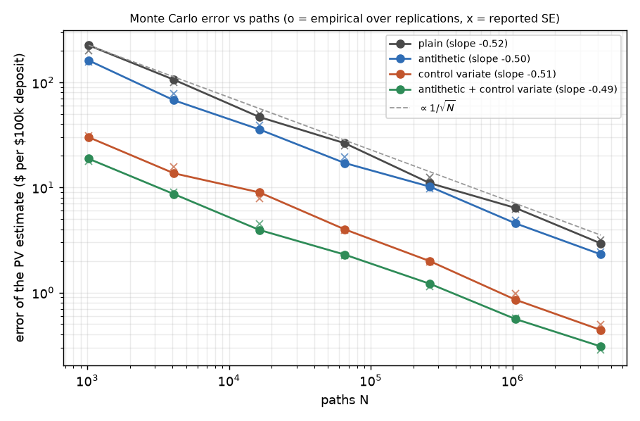

# segfund-mc

An educational Monte Carlo engine for valuing segregated fund (variable annuity)
guarantees, GMMB and GMDB, under Hull-White rates, a correlated equity fund,
Gompertz-Makeham mortality and dynamic lapses. It has a NumPy fp64 reference
engine, an unfused PyTorch GPU engine and a fused Triton kernel, running natively
on Windows.

**This is a teaching model. It is not actuarially approved, not regulatory-grade,
and its assumptions are illustrative.**

## Status

Phases 1 to 3 of 6 are done:
1. CPU fp64 reference model and closed-form validation.
2. GPU kernels (PyTorch unfused, Triton fused), counter-based RNG, and GPU vs CPU
   equality checks.
3. Antithetic variates, a Hull-White put control variate, a convergence study and
   an fp32 precision study.

Risk metrics, nested simulation/LSMC and benchmarks are not built yet.
**There are no quotable speed results yet.** The phase 3 timings all failed the
clock gate: the laptop GPU was power-capped at 1,515 MHz, 49% of max.

## Validation

**Closed forms (CPU fp64):** `segfund validate` runs 27 checks at 200,000 paths
each: Hull-White bond prices, Black-Scholes, GMDB with mortality, a put under
stochastic rates, and the antithetic / control-variate estimators. Raw output:
[`results/validation/phase1_cpu.txt`](results/validation/phase1_cpu.txt). 27/27 pass;
Monte Carlo checks pass when |MC − exact| < 4 standard errors.

**GPU vs CPU on identical scenarios:** `segfund validate --gpu`. Raw output:
[`results/validation/phase2_gpu.txt`](results/validation/phase2_gpu.txt).
57/57 gated checks pass on an RTX 5060 Laptop GPU, 500,000 paths, three contract
variants plus antithetic and Kahan kernel runs. The tolerances were set from an
error budget before the run.
- Philox random words: bitwise identical in NumPy, PyTorch and Triton
  (0 mismatches in 4,194,304 words per case).
- Base contract net PV, fused fp32 vs NumPy fp64: 721.810695 vs 721.812716
  (−2.2e-4 standard errors). Worst single path: $0.187 on a $100,000 deposit.
- The same GPU algorithm in fp64 matches NumPy to 3.18e-15 relative, so the fp32
  differences are precision, not logic.

The first GPU run **failed** one check. Triton's fast `tl.exp` is biased by about
1e-8 per call, which moved a 20-year fee PV by −1.1e-2 standard errors. That run's
output is kept in
[`results/validation/phase2_gpu_run1_tl_exp_FAILED.txt`](results/validation/phase2_gpu_run1_tl_exp_FAILED.txt).
The kernel now uses libdevice math by default. See LEARNING.md §2.4.

**Convergence:** [`results/convergence/convergence.txt`](results/convergence/convergence.txt).
Base contract, 64 independent replications at each N from 2^10 to 2^22.



| Estimator | Slope of log(error) vs log(N), 95% CI | Variance reduction vs plain |
|---|---|---|
| plain | −0.517 [−0.544, −0.491] | 1 |
| antithetic | −0.500 [−0.528, −0.471] | 1.2 – 2.5 |
| control variate (HW put) | −0.508 [−0.546, −0.470] | 27 – 60 |
| antithetic + control variate | −0.489 [−0.515, −0.463] | 82 – 150 |

All four estimators agree with an independent 2^25-path reference (717.18, SE 0.10)
within 1.7 standard errors. The first convergence run (32 replications, keys 1,000
apart) missed −0.5 for the plain estimator. It is kept in
`results/convergence/convergence_run1_*` and discussed in LEARNING.md §3.2.

**Precision:** [`results/precision/precision_study.txt`](results/precision/precision_study.txt).
- Per path, fp32 errors are about 1e-6 relative.
- Summing many paths in a single fp32 running total is not safe: at 2^26 paths it
  got the mean fee wrong by −1,413 dollars per policy (true value about 2,551; the
  MC standard error was 0.076).
- Pairwise, tree, Kahan and fp64 accumulation all stay below 0.003 standard
  errors. The engine reduces in fp64.

## Setup (Windows, no WSL or Docker)

CPU only (this is all CI runs):

```powershell
uv venv .venv --python 3.12
uv pip install --python .venv\Scripts\python.exe numpy PyYAML matplotlib pytest
uv pip install --python .venv\Scripts\python.exe --no-deps -e .
.venv\Scripts\python.exe -m pytest -q
.venv\Scripts\segfund.exe validate
```

GPU (NVIDIA, tested with torch 2.12.0+cu130 and triton-windows 3.8.0.post28):

```powershell
uv pip install --python .venv\Scripts\python.exe torch==2.12.0 --index-url https://download.pytorch.org/whl/cu130
uv pip install --python .venv\Scripts\python.exe triton-windows==3.8.0.post28
.venv\Scripts\segfund.exe validate --gpu
```

The development machine reused an existing torch/triton install from another venv
through a `.pth` file, to avoid a second 2.7 GB download.
`segfund.gpu` sets `CC` and `CUDA_PATH` so triton-windows finds its bundled compiler
in that setup.

## Limits (so far)

- Hull-White a and σ are assumptions, not calibrated (no free Canadian swaption vol data).
- One-factor rates: Gaussian, can go negative, all curve moves perfectly correlated.
- Gompertz-Makeham textbook mortality, no improvement, no sex split. Decrements
  are expected values only, so mortality volatility risk is not captured.
- Lapse function and parameters are illustrative; there is no experience study behind them.
- Resets do not restart the maturity date; no withdrawals, no sales charges.
- The BoC curve loader has not been verified on a real download; it assumes
  continuous compounding.
- Random normals come from 23-bit uniforms, so |z| ≤ 5.77 (the normal tail beyond
  that has probability about 8e-9).
- One fused-kernel launch handles at most 2^31 paths (32-bit path counters).
- fp32 simulation: per-path errors are about 1e-6 relative (measured, above). The
  `FAST_MATH` kernel option has a known small bias and is not used for results.
- The control variate is valid only under the risk-neutral measure, and its beta
  is estimated from the same paths (an O(1/N) bias, not visible at these sizes).
- Speed measurements so far were all taken at a power-capped GPU clock and are
  not quotable under the project's own clock gate.
