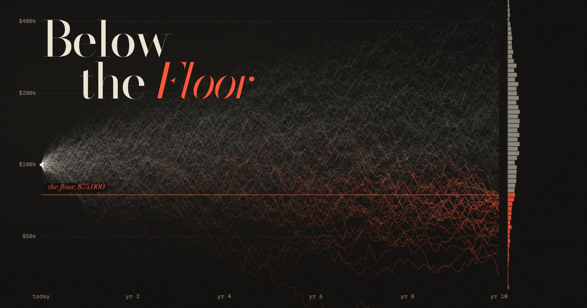
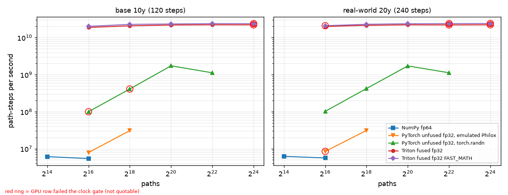

# segfund-mc

An educational Monte Carlo engine for valuing segregated fund (variable annuity)
guarantees, GMMB and GMDB, under Hull-White rates, a correlated equity fund,
Gompertz-Makeham mortality and dynamic lapses. It has a NumPy fp64 reference
engine, an unfused PyTorch GPU engine and a fused Triton kernel, running natively
on Windows.

**Interactive page: [ps12007.github.io/segfund-mc](https://ps12007.github.io/segfund-mc/)**.
The model runs live in your browser.

[](https://ps12007.github.io/segfund-mc/)

**This is a teaching model. It is not actuarially approved, not regulatory-grade,
and its assumptions are illustrative.**

## Status

All six phases are done:
1. CPU fp64 reference model and closed-form validation.
2. GPU kernels (PyTorch unfused, Triton fused), counter-based RNG, and GPU vs CPU
   equality checks.
3. Antithetic variates, a Hull-White put control variate, a convergence study and
   an fp32 precision study.
4. Risk metrics: risk-neutral PV, real-world CTE(70)/CTE(95), and delta and rho
   by common random numbers.
5. Nested simulation (real-world outer, risk-neutral inner) and an LSMC proxy.
6. Clock-gated benchmarks (`segfund bench`) and an HTML report (`segfund report`).

The full write-up, including what went wrong in each phase, is in [LEARNING.md](LEARNING.md).

## Results

Base contract (`configs/base.yaml`): age 55, 10 years, 75% maturity / 100% death
guarantee, 2.25% MER of which 0.40% is the guarantee fee. **All assumptions are
illustrative.** Output of `segfund run --config configs/base.yaml --engine gpu
--paths 4194304`, raw in [`results/runs/base_gpu_4M.json`](results/runs/base_gpu_4M.json).
A 200k-path CPU fp64 run ([`results/runs/base_cpu_200k.json`](results/runs/base_cpu_200k.json))
agrees within its standard errors.

| Per $100,000 deposited | Value | SE |
|---|---|---|
| Risk-neutral PV of claims minus fees | 717.81 | 0.28 |
| Real-world mean PV of claims minus fees | −1,936.85 | 1.78 |
| Real-world CTE(70) | 1,129.22 | 5.49 |
| Real-world CTE(95) | 11,615.58 | 16.75 |
| Delta (PV change per $ of fund value) | −0.11430 | 0.00004 |
| Rho (PV change per +1bp parallel curve shift) | −11.2415 | 0.0057 |

What these mean:
- At hedging cost (risk-neutral), the 0.40% fee doesn't quite cover the guarantee.
- Under real-world scenarios with a 4% equity risk premium, the insurer profits
  in about 90% of scenarios ([`results/risk/risk_study.txt`](results/risk/risk_study.txt)),
  but the worst 5% average an $11.6k loss.


**Nested simulation vs LSMC** (`segfund nested`; study in
[`results/nested/nested_study.txt`](results/nested/nested_study.txt)). Loss at a
1-year valuation date: year-1 cash flows plus the risk-neutral value at t0, over
8,192 real-world scenarios.
- The ground truth used 16,384 inner paths per scenario (134M paths). It ran in
  0.88 s on the GPU, versus about 46 min extrapolated for the NumPy reference.
  Neither time is clock-gated.
- The ground-truth CTE(95) is 5,305.89, with an outer-sampling SE of 88.

| Method (8 replications) | Inner paths | CTE(95) error, RMS |
|---|---|---|
| brute force, 32 inner + control variate | 262,144 | 11.4 |
| brute force, 512 inner, plain | 4,194,304 | 27.4 |
| LSMC, polynomial basis, 2^20 fit scenarios | 2,097,152 | 27.3 (stuck near −24 bias) |
| LSMC, polynomial + put basis, 2^20 fit scenarios | 2,097,152 | 11.4 |

In this model LSMC does not beat brute force with a control variate. Its error is
limited by the choice of basis functions. See LEARNING.md §5.


## Speed

`segfund bench`, raw output in [`results/bench/bench.txt`](results/bench/bench.txt).
RTX 5060 Laptop GPU, performance mode, on AC. Each GPU engine first had to match
the NumPy fp64 reference on the same 65,536 paths. Times are CUDA-event medians
of the launch only. A row is quotable only if the SM clock stayed at or above
70% of max, the GPU stayed below 87 °C, and the IQR was at most 5% of the median.

Base 10-year contract (120 monthly steps), 4,194,304 paths. Every row passes
the clock gate.

| Engine | Time | Fused Triton is |
|---|---|---|
| **Fused Triton kernel** | **23.8 ms** | — |
| PyTorch + `torch.compile` + CUDA graph | 257 ms | **10.8× faster** |
| PyTorch + `torch.compile` | 256 ms | 10.8× faster |
| Plain PyTorch (unfused, `torch.randn`) | 467 ms | 19.6× faster |

- **`torch.compile` is the fair baseline**, and it buys about 1.8× over plain
  PyTorch at this size. It is still 10.8× slower than the fused kernel:
  - It fuses each month's arithmetic, but it still reads and writes the
    whole state and three fresh normals through GPU memory every month, about
    96 bytes per path-step. At about 2e9 path-steps/s that is around 190 GB/s,
    so the compiled engine is memory-bound.
  - The fused kernel keeps the state in registers for all 120 months, generates
    its random numbers in place, and writes 28 bytes per path once.
  - The compiled engines use the same `torch.randn` numbers as plain PyTorch,
    and match it path by path to 1.5e-6.
- **The CUDA graph only matters below about 1M paths**, where launching kernels
  from Python is the bottleneck. At 262k paths it takes the compiled step from
  about 49 ms to 13 ms (both rows too noisy to be quotable, IQR 8–22%). At 4M paths both compiled versions are memory-bound, so
  the graph makes no difference.
- **The fused kernel is compute-bound.** It levels off at about 2.1–2.2e10
  path-steps/s from 1M paths up (16M paths: 94 ms, quotable).
- **Unfused PyTorch with the bit-exact emulated Philox is another order of
  magnitude slower.** It exists for the equality checks, not as a baseline.
- **`FAST_MATH` would be 6–7% faster,** but its `exp` is biased, so it isn't used.
- **NumPy is single-threaded and its rows are not clock-gated.** Its speed
  varied by 2× between runs on this laptop (2.5e6 to 6e6 path-steps/s), depending
  on how hard the CPU was being held back. The fused kernel's throughput is
  3,600–6,800× that. That is a one-core NumPy prototype against a fused GPU
  kernel, not a GPU-vs-CPU figure.



**Earlier runs are kept in `results/bench/`. All four used the same rules:**
- **Run 1 (invalid):** a bug in the warm-up loop queued about a thousand
  launches at a time and overheated the GPU (LEARNING.md §6.3).
- **Run 2:** the first clean run; its 4M-path numbers agree with the current run
  within 5%.
- **Run 3 (`bench_run3_hot`):** most Triton rows failed the 87 °C rule. The
  cool-down before each row only waited for 70 °C, and from there the GPU at
  115 W overheated inside the timing window.
- **Run 4 (current):** waits for 60 °C before each row.

## Report

`segfund report` writes [`results/report/report.html`](results/report/report.html).
It is one self-contained page with the price, the tail distribution,
convergence, the benchmark table and plot, validation and nested results. It is
built from the saved JSON files only; nothing is re-simulated.

## Interactive page

[`web/`](web/) is a static page, *Below the Floor*, that simulates the contract
live in the browser. Open `web/index.html` directly, or serve the folder (for
example from GitHub Pages). It has five parts:
- **The futures:** about 1,400 real-world fund paths drawn as a long exposure,
  with the guarantee floor and the distribution of where they land.
- **Dials:** volatility, floor, fee, age, rate level and equity risk premium.
  Turning one re-runs 16,384 risk-neutral and 16,384 real-world futures in a
  background thread. The ledger shows the cost of the guarantee, the fees, the
  break-even fee, the chance of a loss and CTE(95). The dial settings are kept
  in the URL, so a scenario can be shared as a link (for example
  [28% volatility, 100% floor](https://ps12007.github.io/segfund-mc/?sigmaS=0.28&gmmb=1)).
- **The worst five percent:** drag across the loss histogram to see the futures
  behind any slice.
- **Nested simulation:** one real-world year, then 512 risk-neutral futures from
  where it ends, to value what's left.
- **The race:** a replay of the measured benchmark times for 4M paths.

`web/engine.js` is a line-by-line JavaScript port of the NumPy reference, with
the same Philox stream. `tests/test_web_engine.py` runs it in Node and compares
it with the Python engine on identical seeds:
- Philox words match bit for bit.
- Per-path fund, discount and in-force values agree to 1e-11 relative.
- The estimator, closed-form put and nested segments also match.

The race and nested numbers come from `web/data.js`, which
`scripts/export_web_data.py` generates from `results/`.

## Validation

**Closed forms (CPU fp64):** `segfund validate` runs 36 checks at 200,000 paths
each:
- Hull-White bond prices, Black-Scholes, GMDB with mortality, a put under
  stochastic rates;
- the antithetic and control-variate estimators;
- CTE(70)/(95) against a closed-form lognormal CTE;
- delta and rho against Black-Scholes, and pathwise vs bump-and-revalue delta;
- nested inner values against a closed-form put at t0, and the tower property
  (mean nested loss under risk-neutral outer scenarios = the time-0 PV).

Raw output: [`results/validation/phase1_cpu.txt`](results/validation/phase1_cpu.txt).
36/36 pass; Monte Carlo checks pass when |MC − exact| < 4 standard errors.

The CTE standard-error formula (Manistre–Hancock) was also checked against 32
independent 1M-path replications. Its SEs are 0.89–0.92× the actual spread, which
is within the ±13% uncertainty of that spread.

**GPU vs CPU on identical scenarios:** `segfund validate --gpu`. Raw output:
[`results/validation/phase2_gpu.txt`](results/validation/phase2_gpu.txt).
69/69 gated checks pass on an RTX 5060 Laptop GPU, 500,000 paths: three contract
variants, antithetic and Kahan kernel runs, bumped models (fund shock, curve
shift) and nested simulation (outer states and inner values). The tolerances
were set from an error budget before the run.
- Philox random words: bitwise identical in NumPy, PyTorch and Triton
  (0 mismatches in 4,194,304 words per case).
- Base contract net PV, fused fp32 vs NumPy fp64: 721.810696 vs 721.812716
  (−2.2e-4 standard errors). Worst single path: $0.187 on a $100,000 deposit.
- The same GPU algorithm in fp64 matches NumPy to 3.81e-15 relative, so the fp32
  differences are precision, not logic.
- The kernel's launch shape (BLOCK, num_warps) changes its output bits. Results
  are bitwise identical only between shapes that give each thread the same
  number of paths. Every shape tried has the same error against fp64 to two
  significant figures (sweep: [`results/bench/block_sweep.txt`](results/bench/block_sweep.txt)).

The first GPU run **failed** one check. Triton's fast `tl.exp` is biased by about
1e-8 per call, which moved a 20-year fee PV by −1.1e-2 standard errors. That run's
output is kept in
[`results/validation/phase2_gpu_run1_tl_exp_FAILED.txt`](results/validation/phase2_gpu_run1_tl_exp_FAILED.txt).
The kernel now uses libdevice math by default. See LEARNING.md §2.4.

**Convergence:** [`results/convergence/convergence.txt`](results/convergence/convergence.txt).
Base contract, 64 independent replications at each N from 2^10 to 2^22.


| Estimator | Slope of log(error) vs log(N), 95% CI | Variance reduction vs plain |
|---|---|---|
| plain | −0.517 [−0.544, −0.491] | 1 |
| antithetic | −0.500 [−0.528, −0.471] | 1.2 – 2.5 |
| control variate (HW put) | −0.508 [−0.546, −0.470] | 27 – 60 |
| antithetic + control variate | −0.489 [−0.515, −0.463] | 82 – 150 |

All four estimators agree with an independent 2^25-path reference (717.18, SE 0.10)
within 1.7 standard errors. The first convergence run (32 replications, keys 1,000
apart) missed −0.5 for the plain estimator. It is kept in
`results/convergence/convergence_run1_*` and discussed in LEARNING.md §3.2.

**Precision:** [`results/precision/precision_study.txt`](results/precision/precision_study.txt).
- Per path, fp32 errors are about 1e-6 relative.
- Summing many paths in a single fp32 running total is not safe: at 2^26 paths it
  got the mean fee wrong by −1,413 dollars per policy (true value about 2,551; the
  MC standard error was 0.076).
- Pairwise, tree, Kahan and fp64 accumulation all stay below 0.003 standard
  errors. The engine reduces in fp64.

## Setup (Windows, no WSL or Docker)

CPU only (this is all CI runs):

```powershell
uv venv .venv --python 3.12
uv pip install --python .venv\Scripts\python.exe numpy PyYAML matplotlib pytest
uv pip install --python .venv\Scripts\python.exe --no-deps -e .
.venv\Scripts\python.exe -m pytest -q
.venv\Scripts\segfund.exe validate
```

GPU (NVIDIA, tested with torch 2.12.0+cu130 and triton-windows 3.8.0.post28):

```powershell
uv pip install --python .venv\Scripts\python.exe torch==2.12.0 --index-url https://download.pytorch.org/whl/cu130
uv pip install --python .venv\Scripts\python.exe triton-windows==3.8.0.post28
.venv\Scripts\segfund.exe validate --gpu
.venv\Scripts\segfund.exe bench          # ~3 min; --quick for a smoke test
.venv\Scripts\segfund.exe report         # results/report/report.html
```

Before benchmarking a laptop, plug it in and set the vendor power mode to
performance. Even then, expect the first ~20 s of load to run at a low clock.
The benchmark waits for the clock to settle.

The development machine reused an existing torch/triton install from another venv
through a `.pth` file, to avoid a second 2.7 GB download.
`segfund.gpu` sets `CC` and `CUDA_PATH` so triton-windows finds its bundled compiler
in that setup.

## Limits

- Hull-White a and σ are assumptions, not calibrated (no free Canadian swaption vol data).
- One-factor rates: Gaussian, can go negative, all curve moves perfectly correlated.
- Gompertz-Makeham textbook mortality, no improvement, no sex split. Decrements
  are expected values only, so mortality volatility risk is not captured.
- Lapse function and parameters are illustrative; there is no experience study behind them.
- Resets do not restart the maturity date; no withdrawals, no sales charges.
- The BoC curve loader has not been verified on a real download; it assumes
  continuous compounding.
- Random normals come from 23-bit uniforms, so |z| ≤ 5.77 (the normal tail beyond
  that has probability about 8e-9).
- One fused-kernel launch handles at most 2^31 paths (32-bit path counters).
- fp32 simulation: per-path errors are about 1e-6 relative (measured, above). The
  `FAST_MATH` kernel option has a known small bias and is not used for results.
- The control variate is valid only under the risk-neutral measure, and its beta
  is estimated from the same paths (an O(1/N) bias, not visible at these sizes).
- Benchmarks come from one laptop GPU. Its sustained clock depends on cooling
  and on the vendor's power mode. The PyTorch baseline is unfused eager mode;
  `torch.compile` and CUDA graphs were not tried and would narrow the gap below
  1M paths. NumPy rows are single-threaded and not clock-gated.
- CTE is applied to the PV of net cash flows along each path. Regulatory practice
  uses the greatest present value of accumulated deficiency, with prescribed
  scenario calibration. The real-world assumptions (4% equity risk premium, zero
  market price of rate risk) are not calibrated, and the CTE numbers depend
  heavily on them.
- Pathwise delta only covers contracts without dynamic lapse, resets or later
  deposits. The full model uses bump-and-revalue.
- Nested/LSMC: one valuation date; resets are off, so the guarantee is fixed in the
  state. The LSMC basis is hand-picked and validated only against this model's
  nested runs.
